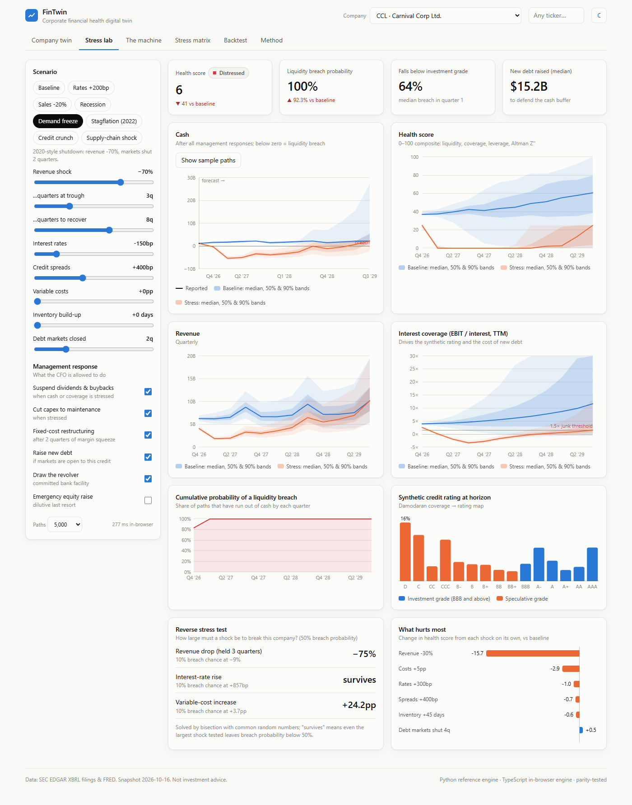

# FinTwin: a financial-health digital twin for public companies

**FinTwin turns a company's SEC filings into a living model of its finances, then stress-tests it thousands of times.** It doesn't predict a stock price. It simulates how cash, debt, margins and credit quality respond to shocks such as a 20% sales drop, a 200bp rate rise or a closed bond market, and it reports a *distribution* of outcomes rather than a single number.



> **30-second pitch.** I built a "flight simulator" for corporate finance. It reads 15 years of a company's official filings and learns how its finances behave: fixed vs variable costs, how fast customers pay, when its debt matures. Then it replays the future 5,000 times under any crisis you choose, right in the browser. Calibrated only on data available in February 2020, it ranked 30 companies' pandemic vulnerability in line with how they actually bled cash (Spearman ρ = 0.56, p = 0.001). Cruise lines and Boeing were flagged as the most fragile.

## What it does

| | |
|---|---|
| **Real data, any ticker** | Pulls XBRL `companyfacts` from SEC EDGAR. Tag drift is handled with ordered fallbacks, and year-to-date cash-flow facts are de-cumulated (Q4 = FY − 9M). Every number links back to its source filing. |
| **System-dynamics model** | 9 stocks (cash, receivables, inventory, payables, customer deposits, PP&E, debt, revolver, equity), quarterly flows, first-order delays, and 4 feedback loops: a leverage–spread spiral, a market-access cliff, cash conservation and delayed restructuring. |
| **Calibrated Monte Carlo** | Fitted per company: robust (MAD) volatilities, Student-t tails, demand–margin correlation, a Vasicek short rate (FRED), a debt maturity ladder, and a rollover policy inferred from the debt trend. |
| **Stress & reverse stress** | 8 scenario presets plus free sliders and 6 CFO levers. Bisection solves "how big a shock breaks this company?". A tornado chart shows sensitivity. |
| **Honest backtests** | Point-in-time vintages: only facts *filed* before the cutoff are visible, so later restatements can't leak. Results are scored by interval coverage and CRPS against naive baselines, with a structural test and a 30-company cross-section. |
| **Two engines, one truth** | A Python reference engine (numpy, vectorized) plus a TypeScript port that runs 5,000 paths in ~150 ms in a Web Worker. Golden parity tests require agreement to 1e-6. |

## Headline results (from `web/public/data/backtest.json`)

* **Pre-COVID vulnerability ranking.** I calibrated twins for 30 companies on filings available by 20 Feb 2020 and ran each through the generic "demand freeze" scenario. That stress health score correlates with the realized worst cumulative free cash flow over 2020–21: **Spearman ρ = 0.56, p = 0.001**. Boeing, American Airlines, MGM and all three cruise lines sit near the bottom of the ranking. The cruise lines (Carnival, Royal Caribbean, Norwegian) went on to burn 72–83% of a year's revenue in cash. Walmart is the visible miss. The score measures structural fragility to a demand collapse, and Walmart never suffered one.
* **Structural fidelity.** When the twin is fed the *realized* revenue path, it reproduces cumulative free cash flow closely in some cases and badly in others:
  * Apple 2020–21: **−2%** error, correlation 0.97.
  * Carnival through the shutdown: −$12.1B simulated vs **−$17.6B actual**, 31% error, correlation 0.68.
  * Boeing and Netflix miss because of 737 MAX advances and content spend, which generic tags can't see.
* **Forecast skill.** Revenue forecasts beat a seasonal random-walk baseline (CRPS) in **67%** of the 12 company × cutoff cases, and cash forecasts in **58%**. Interval coverage is below nominal (revenue 90% bands cover 63%) because both cutoffs sit right before regime breaks. This is documented, not hidden: see [docs/BACKTEST.md](docs/BACKTEST.md).

## The dashboard

| View | What you can do |
|---|---|
| **Company twin** | Health score, breach probability, synthetic rating, breaking point, forecast fans, and every calibrated parameter with its source |
| **Stress lab** | Pick a crisis or drag sliders; toggle CFO responses; get live fan charts, breach-probability curves, rating migration, reverse stress and tornado |
| **The machine** | Animated stock-and-flow diagram with live medians per quarter and the four feedback loops explained |
| **Stress matrix** | 30 companies × 8 scenarios as a heatmap of health score or breach probability |
| **Backtest** | Cross-section scatter, forecast-vs-reality fans, structural test, limitations |

| | |
|---|---|
|  |  |
|  |  |

## Run it

```bash
# 1. engine (Python 3.11+, uv)
cp .env.example .env                       # put your contact email in SEC_USER_AGENT (SEC fair-access rule)
cd engine && uv sync && uv run pytest -q   # 18 tests: property-based balance-sheet identity, PIT, CRPS...
bash scripts/build_all.sh                  # rebuild all snapshots + backtests (~3 min)

# 2. dashboard (Node 20+)
cd ../web && npm ci && npm test            # includes Python <-> TypeScript parity
npm run dev                                # http://localhost:5173

# 3. optional: any ticker, live
cd ../engine && uv run --extra api python -m fintwin.api   # then type a ticker in the header
```

To publish the static dashboard on GitHub Pages later, run `bash scripts/deploy.sh fintwin`. It needs `gh auth login`, and the `.env` file is never pushed.

## Repository map

```
engine/fintwin/
  data/        edgar.py · facts.py (tag fallbacks, YTD de-cumulation, point-in-time) · fred.py · quality.py
  model/       sd_model.py (stock-and-flow core) · ratings.py (Damodaran coverage→rating, Jan 2026)
  stochastic/  calibrate.py · shocks.py · mc.py
  scenarios/   presets.py · reverse_stress.py      sensitivity/ tornado.py
  backtest/    walk_forward.py · scoring.py         export.py · api.py
web/src/
  engine/      model.ts (TS port) · shocks.ts · summary.ts · worker.ts · model.test.ts (parity)
  views/       TwinView · StressLab · MachineView · CompareView · BacktestView · MethodView
docs/          METHODOLOGY.md · BACKTEST.md · CASE_STUDY_CCL.md · CV_KIT.md · screenshots/
```

## Limitations

* The twin covers non-financial corporates only. Banks' balance sheets don't fit this model, and filers that rely on custom taxonomies (e.g. ExxonMobil) can't be parsed with generic tags.
* Unconditional forecasts can't foresee regime breaks. The fans are a tool for ranking and stress testing, not calibrated point forecasts.
* Some parameters are assumptions, and the dashboard labels them as such: committed credit facility, cash floor and target, and a fixed-cost share prior when revenue barely varies.

*Data: SEC EDGAR XBRL, FRED. Rating table: A. Damodaran, Jan 2026. Not investment advice.*
