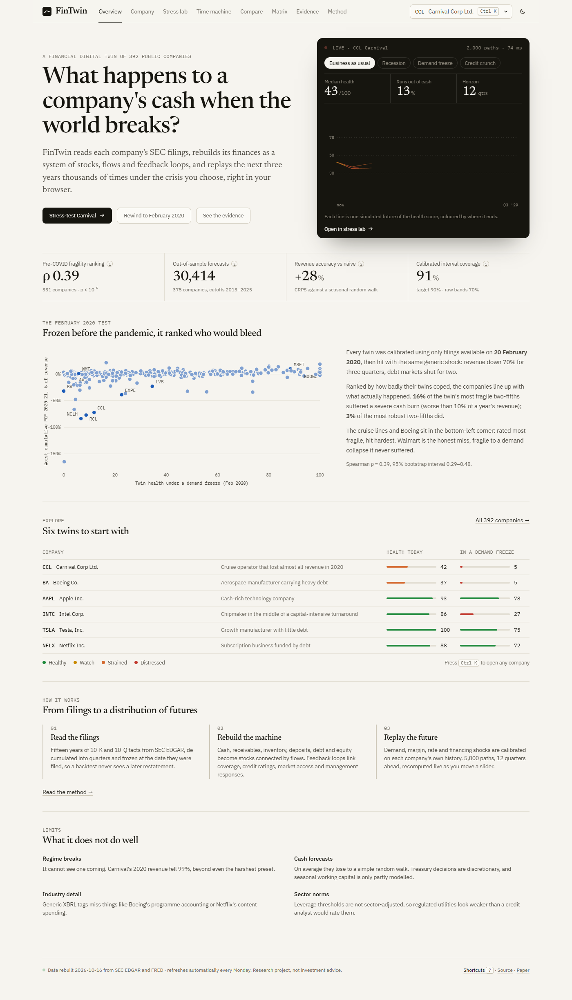

# FinTwin: a financial-health digital twin for public companies

[](https://github.com/SpiliosDimakopoulos/fintwin/actions/workflows/ci.yml)
[](https://github.com/SpiliosDimakopoulos/fintwin/actions/workflows/data.yml)


**[Live dashboard](https://spiliosdimakopoulos.github.io/fintwin/)** · **[Paper (PDF)](docs/paper/fintwin.pdf)** · [Methodology](docs/METHODOLOGY.md) · [Backtest report](docs/BACKTEST.md) · [Carnival case study](docs/CASE_STUDY_CCL.md)

**FinTwin turns a company's SEC filings into a living model of its finances, then stress-tests it thousands of times.** It doesn't predict a stock price. It simulates how cash, debt, margins and credit quality respond to a pandemic, a rate shock or a closed bond market, and it reports a *distribution* of outcomes rather than a single number.


> **30-second pitch.** A flight simulator for corporate finance. It reads 15 years of a company's official filings and learns how its finances behave: fixed vs variable costs, how fast customers pay, when its debt matures. Then it replays the future 5,000 times under any crisis you pick, live in the browser. I froze it in February 2020 and asked which of 331 S&P 500 companies would bleed cash in the pandemic. 22% of the fifth it rated most fragile did, against 3% of the fifth it rated most robust. Boeing came second from the bottom. It now covers 392 companies and rebuilds itself from the latest filings every week.

## Results

All numbers below come from out-of-sample, point-in-time tests: the model sees only the filings that existed on the test date.

| Test | Result |
|---|---|
| **Pre-COVID fragility ranking**: 331 S&P 500 companies frozen on 20 Feb 2020 | Spearman **ρ = 0.39** with realized 2020–21 cash burn (p < 10⁻¹², 95% CI 0.29–0.48). Severe burn (>10% of revenue) hit **22%** of the twin's most fragile quintile and **3%** of its most robust (16% vs 3% for the outer two-fifths). |
| **Revenue forecasts**: 15,212 four-quarter forecasts, 375 companies, cutoffs 2013–2025 | CRPS **28% better** than a seasonal random walk; beats it in 69% of forecasts. |
| **Calibration**: online conformal rescaling, learned only from past cutoffs | 90%-interval coverage raised from 70% (raw) to **91%** (revenue) and from 36% to **91%** (cash), over 30,414 forecasts. |
| **Structural test**: realized revenue fed in, compare cash burn | Apple 2020–21: within 2% of actual free cash flow. Carnival: right shape (corr. 0.66), burn underestimated by 27%. |
| **Engineering** | Python reference engine and TypeScript browser engine agree to 1e-6 on golden runs. The balance sheet balances on every path, checked by property-based tests. |

The twin is also honest about where it fails: [docs/BACKTEST.md](docs/BACKTEST.md).
- Cash forecasts lose to a random walk on average.
- Boeing and Netflix miss the structural test for reasons generic XBRL tags can't capture.
- Walmart is fragile to a demand collapse it never suffered, and thin-margin distributors (Kroger, McKesson) rank fragile for the same reason.
- The universe is today's S&P 500, so companies that failed before 2026 are missing. This survivorship bias likely flatters the cross-section.

## What it does

| | |
|---|---|
| **Point-in-time SEC data** | XBRL `companyfacts` with tag fallbacks, year-to-date de-cumulation, impairment-adjusted EBIT, and *filed-date* vintages that make backtests free of look-ahead bias. Every number links to its source filing. |
| **System-dynamics model** | 9 balance-sheet stocks, quarterly flows, first-order delays and 4 feedback loops: a leverage–spread spiral, a market-access cliff, cash conservation and delayed restructuring. |
| **Calibrated Monte Carlo** | Robust (MAD) volatilities, Student-t tails, demand–margin correlation, a Vasicek short rate, and a Markov recession regime with NBER base rates and company-specific GDP sensitivity. |
| **Stress tools** | 8 crisis presets, free sliders and 6 CFO levers. Reverse stress testing answers "how big a shock breaks it?". Tornado charts and Sobol global sensitivity (with bootstrap CIs) show what matters. |
| **Analyst notes** | A rule-based analyst turns each company's simulation into a credit-memo-style note: verdict, evidenced risks, buffers, scenario commentary, watch list. It is deterministic, so every figure is correct by construction. An optional LLM module writes freer prose from the same fact sheet and machine-checks its figures, if you supply your own key. |
| **Sector-adjusted health** | Leverage that would alarm a software company is normal for a utility. Coverage and leverage are scored against each GICS sector's own norms, which are estimated from the data, and a waterfall shows how each component moves the score. |
| **Time machine** | Rewind any company to what its twin said at every February since 2013, using only the filings that existed then, and see what actually happened next (`#time/CCL`). |
| **Compare** | Put two companies side by side (`#versus/CCL/RCL`), or scan the whole universe × 8 crises, filtered by sector. |
| **Dashboard** | Editorial research-terminal design, light and dark. The landing page runs a live Monte Carlo you can steer. There is a Ctrl K / ⌘K company switcher, a stress lab whose scenarios are shareable as links, peer context on every company, and keyboard shortcuts (press `?`). Everything runs client-side in a Web Worker, so no server is needed. |
| **Always current, at zero cost** | Every Monday a GitHub Actions workflow pulls the newest SEC filings and FRED data, rebuilds all twins across 16 parallel runners, re-runs the validation and the time machine, checks Python–TypeScript parity, and redeploys. |

| | |
|---|---|
|  |  |
|  |  |

## Run it

```bash
cp .env.example .env                       # SEC_USER_AGENT (required by SEC)
cd engine && uv sync && uv run pytest -q   # 27 tests: balance-sheet identity (Hypothesis), offline XBRL end-to-end, point-in-time, CRPS, Sobol...
bash scripts/full_pipeline.sh              # validation (~30k forecasts) + all snapshots + backtests (hours; CI shards it)
cd ../web && npm ci && npm test && npm run dev    # includes Python <-> TypeScript parity
```

Optional extras:
- `uv run python -m fintwin.notes` regenerates the analyst notes. The optional LLM memos need your own API key: `uv run --extra ai python -m fintwin.memo CCL`.
- `uv run --extra api python -m fintwin.api` lets you twin any ticker live.
- `uv run python scripts/paper_assets.py` regenerates the paper's figures and numbers.

## Repository map

```
engine/fintwin/   data/ (EDGAR, facts, FRED) · model/ (stock-and-flow core, ratings) · stochastic/ (calibrate, shocks, MC)
                  scenarios/ (presets, reverse stress) · sensitivity/ (tornado, Sobol) · backtest/ (walk-forward, batch, scoring)
                  universe.py (S&P 500, sector norms) · pipeline.py (sharded weekly build) · export.py · notes.py · memo.py · api.py
web/src/          engine/ (TS port + parity tests) · views/ · charts/
docs/             paper/ (LaTeX + figures, numbers generated from data) · METHODOLOGY · BACKTEST · CASE_STUDY_CCL · CV_KIT
```

*Data: SEC EDGAR XBRL, FRED. Rating table: A. Damodaran (Jan 2026). MIT licence. Not investment advice.*
