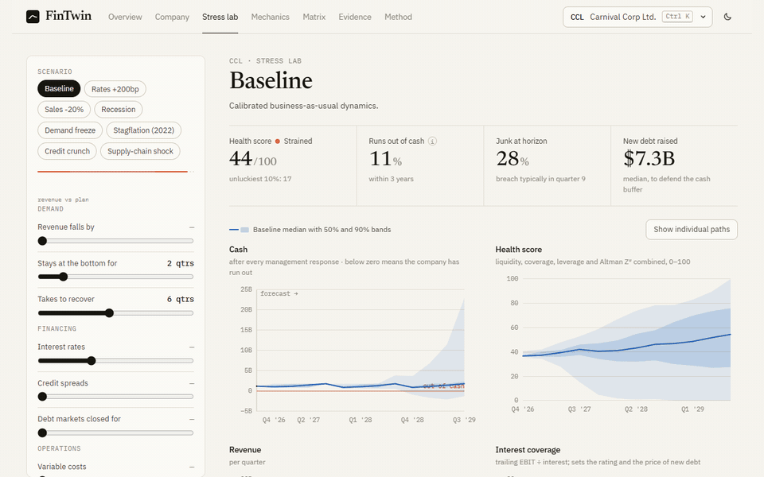
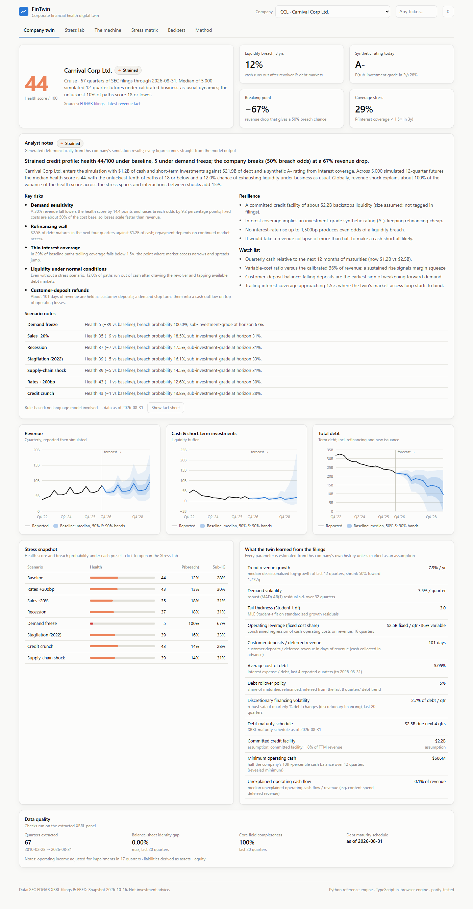
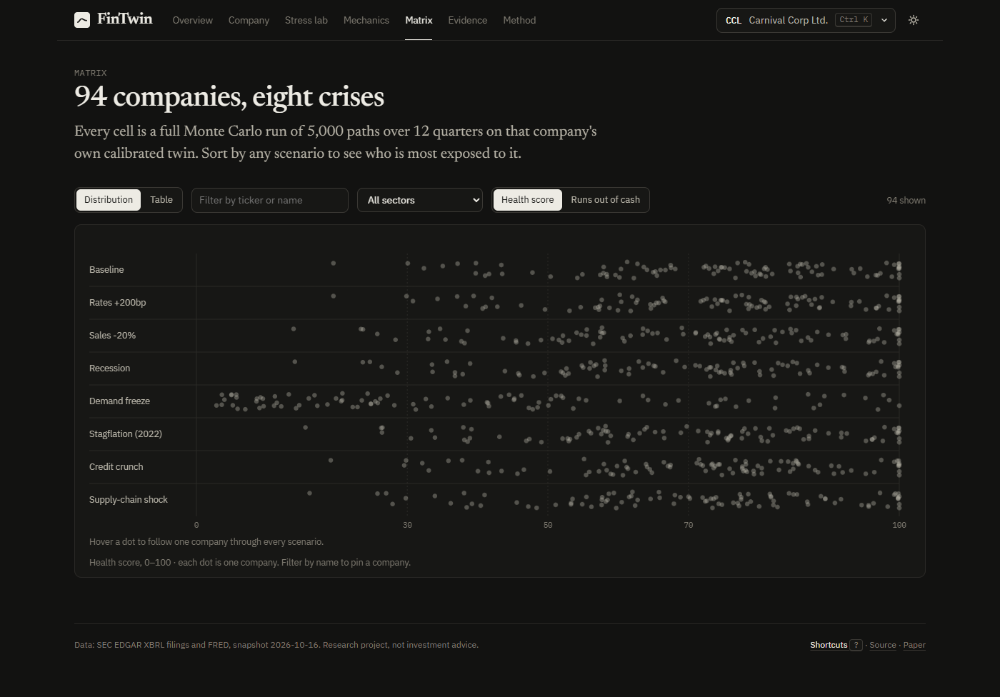
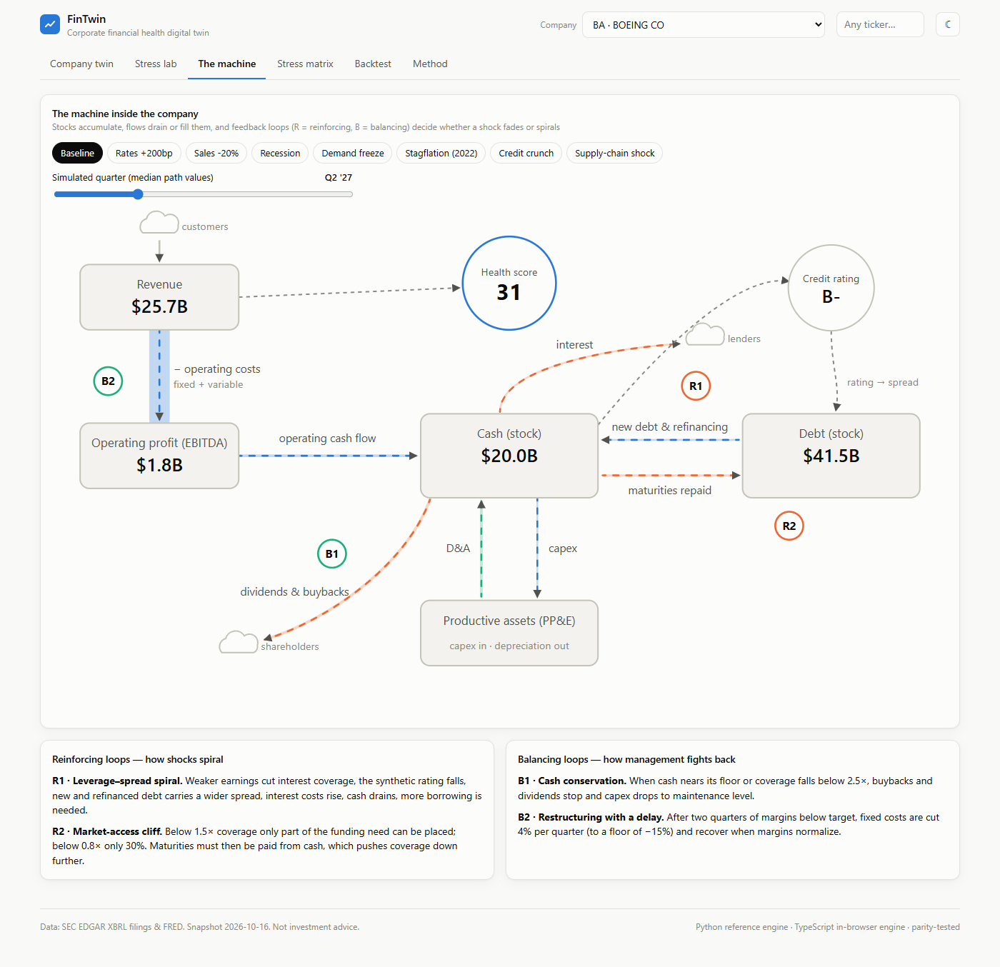
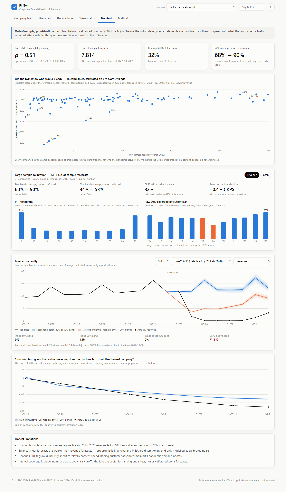

# FinTwin: a financial-health digital twin for public companies

[](https://github.com/SpiliosDimakopoulos/fintwin/actions/workflows/ci.yml)
**[Live dashboard](https://spiliosdimakopoulos.github.io/fintwin/)** · **[Paper (PDF)](docs/paper/fintwin.pdf)** · [Methodology](docs/METHODOLOGY.md) · [Backtest report](docs/BACKTEST.md) · [Carnival case study](docs/CASE_STUDY_CCL.md)

**FinTwin turns a company's SEC filings into a living model of its finances, then stress-tests it thousands of times.** It doesn't predict a stock price. It simulates how cash, debt, margins and credit quality respond to a pandemic, a rate shock or a closed bond market, and it reports a *distribution* of outcomes rather than a single number.



> **30-second pitch.** A flight simulator for corporate finance. It reads 15 years of a company's official filings and learns how its finances behave: fixed vs variable costs, how fast customers pay, when its debt matures. Then it replays the future 5,000 times under any crisis you pick, live in the browser. I froze it in February 2020 and asked which of 88 companies would bleed cash in the pandemic. None of the companies it rated most robust did. About a quarter of those it rated most fragile did, cruise lines and Boeing first.

## Results

All numbers below come from out-of-sample, point-in-time tests: the model sees only the filings that existed on the test date.

| Test | Result |
|---|---|
| **Pre-COVID fragility ranking**: 88 companies frozen on 20 Feb 2020 | Spearman **ρ = 0.51** with realized 2020–21 cash burn (p < 10⁻⁶, 95% CI 0.33–0.65). Severe burn (>10% of revenue) hit **26%** of the twin's most fragile two quintiles and **0%** of its most robust two. |
| **Revenue forecasts**: 3,908 four-quarter forecasts, 94 companies, cutoffs 2013–2025 | CRPS **32% better** than a seasonal random walk; beats it in 69% of forecasts. |
| **Calibration**: online conformal rescaling, learned only from past cutoffs | 90%-interval coverage raised from 68% (raw) to **90%** (revenue) and from 41% to **92%** (cash). |
| **Structural test**: realized revenue fed in, compare cash burn | Apple 2020–21: within 2% of actual free cash flow. Carnival: right shape (corr. 0.66), burn underestimated by 28%. |
| **Engineering** | Python reference engine and TypeScript browser engine agree to 1e-6 on golden runs. The balance sheet balances on every path, checked by property-based tests. |

The twin is also honest about where it fails: [docs/BACKTEST.md](docs/BACKTEST.md).
- Cash forecasts lose to a random walk on average.
- Boeing and Netflix miss the structural test for reasons generic XBRL tags can't capture.
- Walmart is fragile to a demand collapse it never suffered.

## What it does

| | |
|---|---|
| **Point-in-time SEC data** | XBRL `companyfacts` with tag fallbacks, year-to-date de-cumulation, impairment-adjusted EBIT, and *filed-date* vintages that make backtests free of look-ahead bias. Every number links to its source filing. |
| **System-dynamics model** | 9 balance-sheet stocks, quarterly flows, first-order delays and 4 feedback loops: a leverage–spread spiral, a market-access cliff, cash conservation and delayed restructuring. |
| **Calibrated Monte Carlo** | Robust (MAD) volatilities, Student-t tails, demand–margin correlation, a Vasicek short rate, and a Markov recession regime with NBER base rates and company-specific GDP sensitivity. |
| **Stress tools** | 8 crisis presets, free sliders and 6 CFO levers. Reverse stress testing answers "how big a shock breaks it?". Tornado charts and Sobol global sensitivity (with bootstrap CIs) show what matters. |
| **Analyst notes** | A rule-based analyst turns each company's simulation into a credit-memo-style note: verdict, evidenced risks, buffers, scenario commentary, watch list. It is deterministic, so every figure is correct by construction. An optional LLM module writes freer prose from the same fact sheet and machine-checks its figures, if you supply your own key. |
| **Dashboard** | React + Web Worker, no server: 94 companies × 8 scenarios, light/dark, mobile. An optional local API adds any ticker live. |

| | |
|---|---|
|  |  |
|  |  |

## Run it

```bash
cp .env.example .env                       # SEC_USER_AGENT (required by SEC)
cd engine && uv sync && uv run pytest -q   # 20 tests: balance-sheet identity (Hypothesis), point-in-time, CRPS, Sobol...
bash scripts/full_pipeline.sh              # validation (~7.8k forecasts) + all snapshots + backtests
cd ../web && npm ci && npm test && npm run dev    # includes Python <-> TypeScript parity
```

Optional extras:
- `uv run python -m fintwin.notes` regenerates the analyst notes. The optional LLM memos need your own API key: `uv run --extra ai python -m fintwin.memo CCL`.
- `uv run --extra api python -m fintwin.api` lets you twin any ticker live.
- `uv run python scripts/paper_assets.py` regenerates the paper's figures and numbers.

## Repository map

```
engine/fintwin/   data/ (EDGAR, facts, FRED) · model/ (stock-and-flow core, ratings) · stochastic/ (calibrate, shocks, MC)
                  scenarios/ (presets, reverse stress) · sensitivity/ (tornado, Sobol) · backtest/ (walk-forward, batch, scoring)
                  export.py · notes.py (rule-based analyst) · memo.py (optional LLM) · api.py
web/src/          engine/ (TS port + parity tests) · views/ · charts/
docs/             paper/ (LaTeX + figures, numbers generated from data) · METHODOLOGY · BACKTEST · CASE_STUDY_CCL · CV_KIT
```

*Data: SEC EDGAR XBRL, FRED. Rating table: A. Damodaran (Jan 2026). MIT licence. Not investment advice.*
