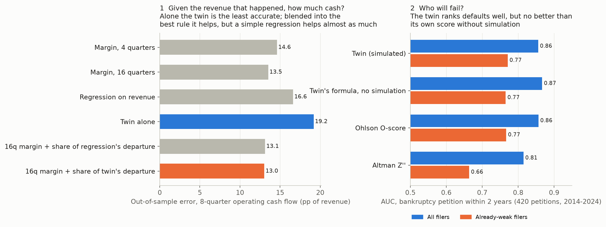

# FinTwin: a financial-health digital twin for public companies

[](https://github.com/SpiliosDimakopoulos/fintwin/actions/workflows/ci.yml)
[](https://github.com/SpiliosDimakopoulos/fintwin/actions/workflows/data.yml)


[](https://doi.org/10.5281/zenodo.23434606)

**[Live dashboard](https://spiliosdimakopoulos.github.io/fintwin/)** · **[Paper (PDF)](docs/paper/fintwin.pdf)** · [Methodology](docs/METHODOLOGY.md) · [Backtest report](docs/BACKTEST.md) · [Carnival case study](docs/CASE_STUDY_CCL.md)

**FinTwin turns a company's SEC filings into a living model of its finances, then stress-tests it thousands of times.** It doesn't predict a stock price. It simulates how cash, debt, margins and credit quality respond to a pandemic, a rate shock or a closed bond market, and it reports a *distribution* of outcomes rather than a single number.


> **30-second pitch.** A flight simulator for corporate finance. It reads 15 years of a company's official filings and learns how its finances behave: fixed vs variable costs, how fast customers pay, when its debt matures. Then it replays the future 5,000 times under any crisis you pick, live in the browser. Then I tested it the hard way. Frozen in February 2020, it beat the Altman, Ohlson and Zmijewski scores at ranking who would burn cash, but a simple trailing cash-flow margin beat it, and neither it nor the classic scores predicted who the shock would actually hit. What the twin does well is the other half of a stress test: given the revenue that actually happened, it knows where cash departs from a simple margin rule, consistently over ten years. It covers 390+ companies and rebuilds itself from the latest filings every week.

## Results



All numbers below come from out-of-sample, point-in-time tests: the model sees only the filings that existed on the test date.

| Test | Result |
|---|---|
| **Transmission (structural test)**: realized revenue fed into each twin, 2,661 firm-years 2014–2023 | The twin knows where a margin pass-through rule misjudges cash flow: incremental **ρ = 0.30** (95% CI 0.25–0.36), positive in **every year**. In 2020, for companies whose revenue fell >10%, operating cash flow tracked with **ρ = 0.72 vs 0.27** for the rule (across all revenue declines in 2014–2023 the two are level, and the rule has smaller errors in levels). |
| **Ranking before COVID**: 333 S&P 500 non-financials frozen on 20 Feb 2020 | Twin ρ = 0.40 with 2020–21 cash burn, above Altman Z″ (0.31), Ohlson, Zmijewski and every leverage/coverage ratio. **But** the trailing FCF margin reaches 0.68, and against each company's own run-rate (the shock-induced part) neither the twin nor the classic scores rank 2020; only revenue volatility and capital intensity carry weak signal. |
| **2020 bankruptcies**: 27 Chapter 11 filers vs size-matched survivors | AUC 0.95 vs 0.88 for Altman Z″ (p = 0.02). The twin's scoring formula on the opening balance sheet does as well (0.96): the signal is in the score, not the simulation. |
| **Revenue forecasts**: 15,112 forecast–horizon pairs, 374 companies | Scaled CRPS **27% better** than a seasonal random walk and **18% better** than ETS; Diebold–Mariano tests significant with firm × origin clustering. |
| **Calibration**: online conformal rescaling, learned only from past cutoffs | 90%-interval coverage raised from 70% (raw) to **91%** (revenue) and from 36% to **91%** (cash). |
| **Engineering** | Python reference engine and TypeScript browser engine agree to 1e-6 on golden runs. The balance sheet balances on every path, checked by property-based tests. |

Where it fails, in the paper's own words ([docs/paper/fintwin.pdf](docs/paper/fintwin.pdf)):
- It does not predict *who* a crisis will hit: fundamentals-based fragility rankings, the twin's included, mostly measure persistent cash-flow habits.
- Its feedback loops barely change the ranking of companies.
- Cash forecasts lose to a random walk and to ETS; in quiet years the margin rule has smaller errors in levels.
- The universe is today's S&P 500 (survivorship bias); the 2020 bankruptcy test addresses it for one year only.

## What it does

| | |
|---|---|
| **Point-in-time SEC data** | XBRL `companyfacts` with tag fallbacks, year-to-date de-cumulation, impairment-adjusted EBIT, and *filed-date* vintages that make backtests free of look-ahead bias. Every number links to its source filing. |
| **System-dynamics model** | 9 balance-sheet stocks, quarterly flows, first-order delays and 4 feedback loops: a leverage–spread spiral, a market-access cliff, cash conservation and delayed restructuring. |
| **Calibrated Monte Carlo** | Robust (MAD) volatilities, Student-t tails, demand–margin correlation, a Vasicek short rate, and a Markov recession regime with NBER base rates and company-specific GDP sensitivity. |
| **Stress tools** | 8 crisis presets, free sliders and 6 CFO levers. Reverse stress testing answers "how big a shock breaks it?". Tornado charts and Sobol global sensitivity (with bootstrap CIs) show what matters. |
| **Analyst notes** | A rule-based analyst turns each company's simulation into a credit-memo-style note: verdict, evidenced risks, buffers, scenario commentary, watch list. It is deterministic, so every figure is correct by construction. An optional LLM module writes freer prose from the same fact sheet and machine-checks its figures, if you supply your own key. |
| **Sector-adjusted health** | Leverage that would alarm a software company is normal for a utility. Coverage and leverage are scored against each GICS sector's own norms, which are estimated from the data, and a waterfall shows how each component moves the score. |
| **Time machine** | Rewind any company to what its twin said at every February since 2013, using only the filings that existed then, and see what actually happened next (`#time/CCL`). |
| **Compare** | Put two companies side by side (`#versus/CCL/RCL`), or scan the whole universe × 8 crises, filtered by sector. |
| **Dashboard** | Editorial research-terminal design, light and dark. The landing page runs a live Monte Carlo you can steer. There is a Ctrl K / ⌘K company switcher, a stress lab whose scenarios are shareable as links, peer context on every company, and keyboard shortcuts (press `?`). Everything runs client-side in a Web Worker, so no server is needed. |
| **Ask the twin** | Describe a crisis in plain English ("revenue falls 40% for a year and banks stop lending", "another 2008 for Carnival") and the stress lab sets it up and simulates it. Built-in rules work everywhere; an optional on-device language model (Qwen2.5 1.5B via WebLLM, no API key, nothing leaves the browser) handles free-form text. Language only chooses the scenario: model output is validated and clamped, and every number comes from the simulation. |
| **What changed this week** | Each Monday's rebuild is compared with the previous one: which companies' health moved by 5+ points, after which filing, and which part of the score (runway, coverage, leverage, solvency) drove it. Also as an RSS feed. |
| **Always current, at zero cost** | Every Monday a GitHub Actions workflow pulls the newest SEC filings and FRED data, rebuilds all twins across 16 parallel runners, re-runs the validation and the time machine, checks Python–TypeScript parity, and redeploys. |

| | |
|---|---|
|  |  |
|  |  |

## Run it

```bash
cp .env.example .env                       # SEC_USER_AGENT (required by SEC)
cd engine && uv sync && uv run pytest -q   # 27 tests: balance-sheet identity (Hypothesis), offline XBRL end-to-end, point-in-time, CRPS, Sobol...
bash scripts/full_pipeline.sh              # validation (~30k forecasts) + all snapshots + backtests (hours; CI shards it)
cd ../web && npm ci && npm test && npm run dev    # includes Python <-> TypeScript parity
```

Optional extras:
- `uv run python -m fintwin.notes` regenerates the analyst notes. The optional LLM memos need your own API key: `uv run --extra ai python -m fintwin.memo CCL`.
- `uv run --extra api python -m fintwin.api` lets you twin any ticker live.
- `uv run python scripts/paper_assets.py` regenerates the paper's figures and numbers.

## Repository map

```
engine/fintwin/   data/ (EDGAR, facts, FRED) · model/ (stock-and-flow core, ratings) · stochastic/ (calibrate, shocks, MC)
                  scenarios/ (presets, reverse stress) · sensitivity/ (tornado, Sobol) · backtest/ (walk-forward, batch, scoring)
                  universe.py (S&P 500, sector norms) · pipeline.py (sharded weekly build) · export.py · notes.py · memo.py · api.py
web/src/          engine/ (TS port + parity tests) · views/ · charts/
docs/             paper/ (LaTeX + figures, numbers generated from data) · METHODOLOGY · BACKTEST · CASE_STUDY_CCL · CV_KIT
```

*Data: SEC EDGAR XBRL, FRED. Rating table: A. Damodaran (Jan 2026). MIT licence. Not investment advice.*
